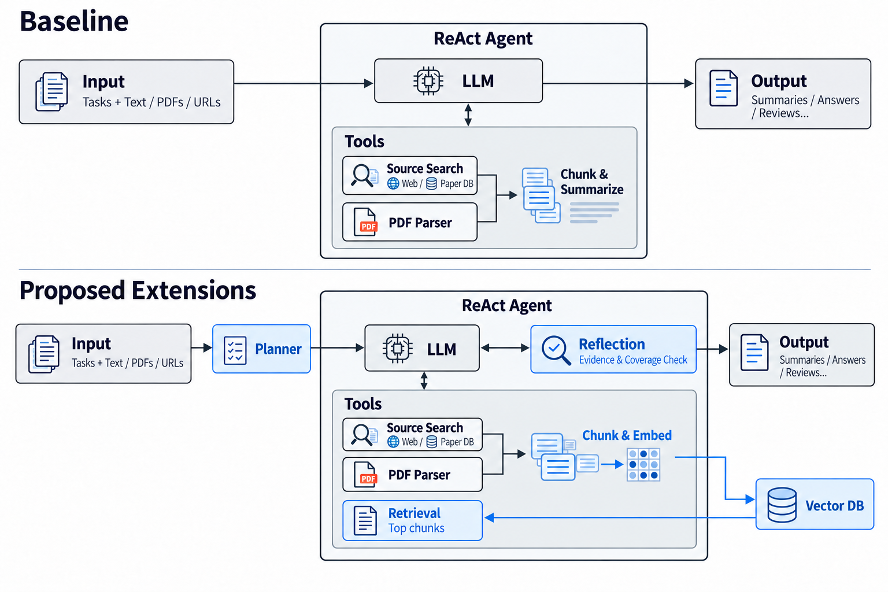

# Agent

- [Standalone quick start](#standalone-quick-start)
- [Agent workflow](#agent-workflow)
- [Ablation test](#ablation-test)

## Standalone quick start

Install uv and Python 3.12. From the repository root, enter the Agent directory and set it up once.

```sh
cd agent
uv sync --frozen
cp -n .env.example .env
```

Set `BAILIAN_API_KEY` in `.env` and check `MODEL_BASE_URL` and `MODEL_NAME` for your account. Choose one command below. Both use the preselected *Attention Is All You Need* paper and run without a backend or database.

```sh
# Baseline
uv run python baseline.py --task examples/qa.json

# Retrieval Extension, with optional planning and reflection enabled
uv run python extension.py --task examples/qa.json --planner --reflection
```

Use `examples/summary.json` for a summary of the same paper. For an arXiv search, set `TAVILY_API_KEY` and use `examples/review.json` or `examples/discovery.json`. The Extension uses the same Bailian key for embeddings (default model `text-embedding-v4`).

Results are saved under `agent/runs/baseline/` or `agent/runs/extension/`. To also save an individual run to Neon, set `DATABASE_URL` and pass `--persist`.

## Agent workflow

[](workflow.svg)

The agent chooses tools based on the research question, reads the papers, and cites the passages that support its answer.

### Tools

| Tool | Description |
| --- | --- |
| `search_papers` | Search arXiv for papers. Returns candidates with source IDs and snippets. Snippets are discovery leads, not citation evidence. |
| `search_library` | Search the user's library by keywords in paper titles. |
| `open_paper` | Open a paper and return its title, page count, and section outline. |
| `read_paper` | Read 1–3 pages of original PDF text. Returns new chunks with citation IDs. A fully read range returns already_read with no new text. |
| `summarize_paper` | Summarize up to six PDF pages. Returns short summaries with chunk citations. A fully summarized range returns already_summarized. |
| `retrieve` | Find passages by meaning across one or more papers. Returns the best-matching passages with source IDs, page numbers, and chunk IDs. |

### Nodes

- **Planner** identifies what the task asks for and which evidence might be easy to overlook. It suggests 1–3 steps the agent can adapt as it reads, or returns `NO_PLAN` when the next step is clear.
- **Reflection** checks whether the draft answers the question and whether the cited PDF passages support its conclusions, experimental conditions, and table entries. It accepts a complete, well-supported answer or revises the draft. If one more passage could settle an open question, it calls `read_paper` or `retrieve` once before finalizing. It records any remaining gaps in `unresolved`.

### Context compression

When the estimated input and reserved output together reach 90% of the context window, the `compact` policy trims redundant tool results. If the total still meets or exceeds that threshold, the model stops gathering evidence and answers with what it has. The default `full` policy keeps the entire history and proceeds directly to the answer at the same threshold.

## Ablation test

The five test cases in `agent/examples/` each run under all five configurations, for 25 runs in total.

| Test case | Task |
| --- | --- |
| `library-qa` | Find the SkillOpt paper in the user's library. Explain what SkillOpt optimizes and how it decides whether to keep an update. |
| `qa` | Use *Attention Is All You Need* to explain why scaled dot-product attention divides the dot product by √dₖ. |
| `summary` | Summarize *Attention Is All You Need*, covering its research question, method, translation results, and the conditions under which those results apply. |
| `review` | Find the original LoRA and QLoRA papers. Compare the methods and how each saves GPU memory. |
| `discovery` | Find representative papers on agents that improve their own skills. Explain how each approach uses experience to update existing skills. |

| Configuration | RAG (`retrieve`) | Planner | Reflection |
| --- | --- | --- | --- |
| `baseline` | Off | Off | Off |
| `rag` | On | Off | Off |
| `rag-planner` | On | On | Off |
| `rag-reflection` | On | Off | On |
| `full` | On | On | On |

## How to run the tests

**Run the full ablation test.** Some of the 25 runs use your paper library. Follow the root README to start the backend, then sign in with a verified account. Import or upload the SkillOpt paper and check that a library search for `SkillOpt` finds it. From the repository root, pass your library username and password as the two arguments.

```sh
./agent/run.sh 'username' 'password'
```

Each run writes `result.json` and `trace.json` to `agent/runs/ablation/<batch>/<case>/<configuration>/`.
