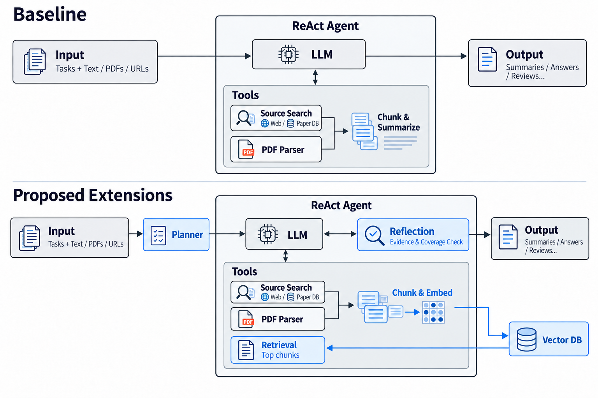

# Agent workflow

本文区分当前 baseline 与后续 extensions；功能效果随评测验证。模块关系沿用下图，箭头表示数据流与调用反馈，执行顺序由 agent 根据任务和观察决定。

## 任务与接口

| 任务 | 主要输出 | 关注点 |
|---|---|---|
| 论文总结 | 研究问题、方法、结果、实验条件与局限的总结 | 覆盖主要章节，保留结论适用条件 |
| 论文 QA | 带引用的回答、依据与无法判断之处 | 对齐问题与原文，区分报告事实和推断 |
| 课题综述与比较 | 限定范围的综述及关联支持段落的比较表 | 跨论文综合、字段覆盖、实验条件可比性 |

当前输入包含 `task_id`、`question`、arXiv ID/URL、是否允许搜索、篇数上限，以及 `max_steps`、`timeout_seconds`、`max_output_tokens`。`question` 直接表达问答、总结、比较或混合要求，由 agent 据此选择工具和组织回答。任务与结果类型见 [schemas.py](schemas.py)。本地文本/PDF、更多资料过滤条件和 `baseline / extended` 切换留待扩展接入。

输出包含正文、比较表（适用时）、引用与证据定位、未解决项、停止原因和运行统计。表格按字段关联证据，区分未报告、不适用、证据不足和冲突。

## Baseline

一个 ReAct agent 根据任务、历史和工具反馈选择搜索、打开论文、阅读、补读原文或结束。主图只有 agent 和 tools 两个节点；工具由 `@tool` 定义，当前按返回顺序串行执行。系统提示要求先打开论文查看导航信息，再选择阅读范围；模型不再请求工具且返回最终 JSON 时结束。

| 工具或处理 | 行为 |
|---|---|
| `search_papers` | 搜索 arXiv 候选；搜索片段只用于发现，不作引用证据 |
| `open_paper` | 下载、解析并缓存论文，返回标题、版本、总页数及 PDF 书签目录 |
| `read_paper` | 读取允许论文的 1–3 页原文块，返回页码、chunk ID 和总页数 |
| `summarize_paper` | 将最多 6 页分批交给模型摘要，摘要引用关联原文块 |

打开、阅读与摘要共用论文加载和缓存；打开论文只返回导航信息，原文证据在读取或成功摘要后登记。PDF 本地缓存；启用持久化时，论文及结果保存到数据库。原文与摘要分别去重，摘要后可再读取原文核实。摘要工具的现有策略暂保留，后续单独评估。

主模型调用前经 `prepare_context` 准备一次输入视图并估算容量；默认保留完整历史，不压缩。`run_task` 可注入主 agent 的 `context_policy`，返回的模型视图与保存的历史分离；摘要独立准备输入，只使用默认策略。输入估算加本次输出额度达到窗口的 `context_finalize_ratio`（默认 `0.8`）且未超过硬上限时，使用该视图追加作答指令，经过硬容量检查后发起一次无工具收尾，基于已有证据作答并说明缺口。超限或失败不裁剪、不循环重试。

## Extensions

第一版 Extension 复用现有 ReAct 图、论文工具与 context 策略，新增 `retrieve`。该工具在指定的一篇或多篇论文中联合检索。首次检索时复用已打开论文的解析结果，逐篇按需为原文块建索引并缓存在本地。每次调用生成一个查询向量，在全部选中论文中按余弦相似度取全局前 `top_k` 个块，仅登记实际返回的原文块为检索证据。后续 Planner 与 Reflection 可通过同一模型的独立调用实现，届时再确定构图。历史压缩等策略可通过已有 `prepare_context` 接口继续扩展。

| 模块 | 职责与返回内容 |
|---|---|
| Planner | 将要求展开为子问题、输出字段和调查顺序；维护可更新的覆盖清单 |
| Chunk & Embed | 将获取的正文分块、生成向量，保留原文和来源定位 |
| Vector DB | 存储文本块、向量及来源信息，供已获取材料的重复检索 |
| Retrieval | 在允许的文献范围内按子问题检索，返回相关原文、定位及必要的相邻上下文 |
| Reflection | 对照任务、覆盖清单、候选输出及所引原文，返回具体缺口和修订/结束建议 |

存储与读取路径为 **Chunk & Embed → Vector DB → Retrieval**。Paper DB 管文献，Vector DB 管可检索文本块；embedding 后仍由 LLM 阅读证据、综合作答。检索后的问题定向摘要可按上下文需要加入。

覆盖清单记录待查、已有证据、证据不足或冲突。Reflection 发现缺口后交回 agent：补读已有材料、改写库内查询、在允许时补搜新文献，或收紧结论。论文总结按章节和总结维度取证；检索遗漏时可按位置补读。

## 证据与状态

证据记录至少包含 `source_id`、`paper_id`（适用时）、版本、`chunk_id`、章节或页码及 `source_text`。摘要、答案论断和比较表单元格关联这些记录；可用的定位精度由解析结果决定。

当前 `GraphState` 仅保存消息、停止原因和最终输出；资料、证据及运行记录由单次运行维护。以下是研究过程涉及的信息，后续按实际需要调整状态结构：

| 状态项 | 内容 |
|---|---|
| Task | 原问题、输出要求、允许来源、主 agent 轮数和时间上限 |
| Sources | 候选与纳入文献、版本、全文状态、去重和筛选记录 |
| Evidence | 原文块、摘要、来源定位、论断或比较字段的证据关联 |
| Progress | 工具历史、候选输出、未解决项；扩展另含覆盖清单与检查反馈 |
| Usage | 时间、API 返回的 token、主 agent 轮数、模型/工具调用数与错误 |

整任务限制为最大主 agent 轮数与时间，默认分别为 40 轮和 600 秒；自然最终回答和压力收尾都占一轮，摘要调用另计入模型用量。到限直接停止并保存 `stop_reason`、证据和 trace；不因最后一轮、剩余时间或无进展提前收尾。时间在调用前后检查，并限制单次请求超时。

运行参数 `context_window` 默认 `32000`，不是任务字段；每次调用的估算输入加本次输出额度超过窗口时，记录 `kind="context"` 并停止为 `context_limit`，不增加实际模型调用数或主 agent 轮数。Python 传 `context_window=None` 关闭本地上限及压力收尾；仅禁用收尾可传 `context_finalize_ratio=None`。服务端容量错误仍记录 `context_limit`。本地计数先按字符、消息包装和工具定义估算，后续在历史前缀及工具定义匹配时，以 API 输入用量校准并估算新增内容；主 agent 与摘要分别计数。该估算不等于服务端 tokenizer，不补入 API usage。

收尾触发记录为 `kind="context", action="finalize", reason="context_pressure"`，实际模型调用为 `purpose="finalize"` 并计入主 agent 轮数和模型成本。触发原因与最终结果分开：收尾回答仍经原有解析、引用与未解决项检查，可能为 `completed`、`partial` 或错误状态。

## 实现顺序

1. 固定输入、输出和证据结构，接通模型客户端，用单篇 QA 跑通 ReAct 调用、补读、引用和停止。
2. 接入 Source Search 与长文分块摘要，覆盖论文总结、综述和比较表；保留可复现的 baseline 配置与 trace。
3. 验证 context 压力收尾，先在独立的 Extension 入口接入按需建索引与 Retrieval，沿用 Baseline 的执行与收尾。
4. 跑通并完善 Extension 后，根据实际差异决定模块化范围与后续 context 策略。Planner 与 Reflection 留待后续讨论。
5. 用相同任务与允许资料检查遗漏、无证据回答、不同实验条件和全文不可得等情况，记录策略与成本差异，按结果调整实现。

Baseline 使用 LangGraph、搜索 API、PDF parser 和 PostgreSQL。首版 Extension 使用百炼 embedding 与本地向量索引，后续再评估 pgvector。

## 评测接口与相关文档

两版共享任务与结果格式。Trace 记录工具参数及来源、证据、候选输出、检查反馈、耗时和消耗，支持回放与失败分析。控制、摘要、规划、反思和修订调用均计入模型成本；embedding 与建库另计，并标明是否复用索引。

整体任务、对照设置和评分见 [项目方案](../docs/design.md)；模块对接约定维护在 [interfaces](interfaces.md)，平台入口见 [TACC](../tacc/README.md)。主流程通过模型客户端调用 TACC 服务。

设计主要借鉴 [PaperQA2](https://arxiv.org/html/2409.13740v2) 的动态调查：搜索文献、收集证据、尝试回答，再决定继续或结束。这里的 extensions 相对于本项目 baseline。
