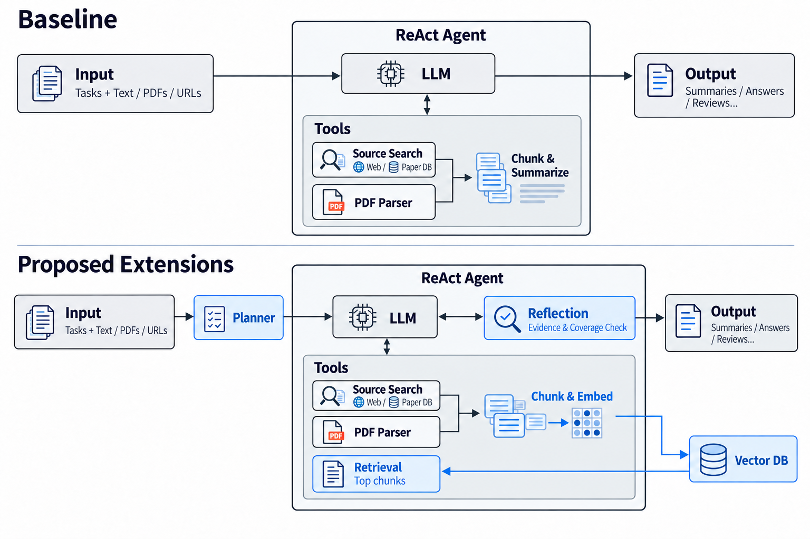

## CSIT6000V Advanced AI Computing and Systems: Project Proposal - Literature Research Agent Assistant

Group members: 21343900 GUO, Jianyang, 21383326 MO, Dapeng, 21390666 ZHANG, Zihan, 21340128 ZHOU, Nanxin

------

### 1. Motivation and Task

Conducting literature reviews is time-consuming, as researchers must identify relevant papers and synthesize findings, while LLM-generated summaries may overlook key details or lack evidence support.

We propose a Literature Research Agent Assistant that helps students and early-stage researchers explore focused topics by searching and analyzing papers, generating evidence supported literature reviews and cross-paper comparison tables, and answering paper-specific questions . Potential extensions include research knowledge graphs and research gap discovery.

### 2. Proposed System

#### 2.1 System Architecture

The system consists of four components: **frontend, application backend, agent framework, and model serving** . RAG and PostgreSQL support evidence retrieval and data management . The frontend communicates with the backend through RESTful APIs, while LangGraph coordinates agents and vLLM serves the Qwen 27B model on TACC.

#### 2.2 Frontend

The frontend will use **React** and **TypeScript**, supported by Vite, Axios, Ant Design, React Router, React Markdown, and ECharts . It will allow users to submit research questions, search for papers, upload PDFs, and request literature reviews or paper-specific answers . Results, comparison tables, and supporting evidence will be displayed through the interface.

#### 2.3 Application Backend

**FastAPI** will accept tasks and papers, expose progress and results, and dispatch work through a TaskManager to a LangGraph Agent Worker using Qwen served by vLLM on TACC . Generated outputs willbe saved in an Artifact Store, while execution traces and logs will be recorded in a Trace/Log Store .

The baseline uses a ReAct agent with two tools: Source Search (web and local Paper DB) and PDF Parser . It selects actions based on task requirements and tool feedback, such as searching, reading documents, and revising answers . Long texts are chunked and summarized when needed, while evidence checking is guided by system prompts .

The proposed extensions add a Planner to decompose research questions and identify required evidence,vector-based retrieval for relevant passages, and a Reflection node to check evidence support and coverage . Identified gaps can trigger follow-up searches or revisions .

Optional future optimization: A knowledge graph can be added alongside the chunk & embed process, with entity and relation extraction to connect papers, methods, and findings. Multi-agent, where a planner coordinates paper-reading agents and integrates their evidence.

Reused components and group implementation: We plan to use LangGraph for the agent workflow, along with search APIs, a PDF parser, and an embedding API. Our proposed storage setup uses PostgreSQL for paper metadata and workflow checkpoints, with pgvector for passage retrieval . Specific implementation choices will be validated during prototyping .

#### 2.4 Model Serving

We will deploy **Qwen 27B** on TACC GPU nodes using **vLLM** as an HTTP-based inference service. All agents will share this service rather than loading separate model instances . Potential optimizations include continuous batching, KV-cache management, prefix caching, and quantization, subject to hardware and model compatibility .

### 3. Evaluation Plan

#### 3.1 Tasks and Data

We will evaluate **paper summarization, evidence-grounded QA, and literature review generation with cross-paper comparison**. Data will include public benchmarks (e.g., QASPER) and a small annotated paper corpus covering dispersed evidence, missing information, conflicting findings, and incomparable settings.

#### 3.2 Agent Evaluation

We will compare the baseline ReAct agent and extended workflow under identical models, inputs, sources, and execution budgets. Metrics include **Key-Fact Coverage, Answer Accuracy, Comparison Accuracy, and Citation Support Rate**. Human reviewers will assess factual correctness and evidence support, with optional LLM-based evaluation and ablation studies.

#### 3.3 Model Serving Evaluation

Using the same Qwen 27B model, GPU hardware, and prompts, we will compare baseline and optimized vLLM configurations. Metrics include **Latency** (TTFT, TPOT, end-to-end latency), **Throughput** (output tokens/sec, requests/sec), **Resource Utilization** (GPU memory and utilization), and **Token Consumption** (input, output, and total tokens).

#### 3.4 End-to-End Evaluation

We will measure **task completion rate, end-to-end latency, and computational cost**, tracking token consumption, model/tool calls, and GPU runtime. Execution traces will help identify failures such as missing evidence, incorrect synthesis, and unsupported citations.