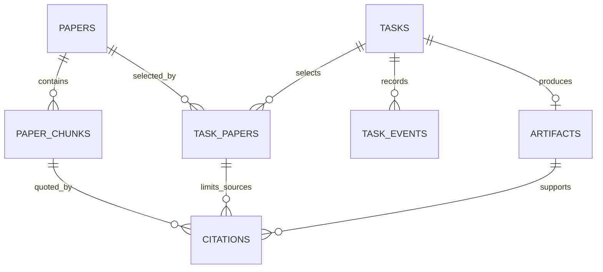

# 后端数据库设计

版本：v1 · 更新日期：2026-11-12。需求依据：`docs/Proposal.md`；接口对应 `docs/api-contract.md`；当前参考 DDL：`backend/sql/schema.sql`。第 9 节为 MVP-3 待实施增量设计，不表示新表/迁移已存在。

本文记录数据设计；应用通过 backend/alembic 的版本迁移建库，backend/sql/schema.sql 保留作结构对照。模型和迁移已落地，操作说明见 backend/README.md；未连接现有业务数据库。

## 1. 设计决策

- 目标使用 PostgreSQL 17+；应用层使用 SQLAlchemy 2 + psycopg 3，迁移用 Alembic。UUID 由应用或 PostgreSQL 原生 gen_random_uuid() 生成，不依赖额外扩展。
- 当前是单用户 MVP，不增加用户、工作区和权限表。增加多用户时需补归属、访问控制和幂等键作用域，不能只改页面。
- PDF 保存到 STORAGE_ROOT/uploads；正文、比较表、引用与事件保存数据库。首版不额外部署对象存储、Redis 或独立日志数据库。
- 七张目标表中，MVP-0 使用五张核心表；MVP-1A 开始写入真实解析的 paper_chunks，citations 仍只由后续 Runner 依据证据写入，Mock 不生成伪造片段或引用。
- 引用使用关系表，避免在 artifact JSON 中再保存一套引用；比较表是结构可变的展示数据，采用 JSONB。
- Agent checkpoint 由 LangGraph checkpointer 管理独立 schema，应用不手工复制它的内部表；task_id 与 thread_id 对应关系由适配器维护。
- 暂不固定 embedding 维度或创建向量索引；按组员确定的 embedding 模型再迁移增加 pgvector 数据。

### 关系图



### 通用规则

UUID 为主键；时间使用 timestamptz，应用会话按 UTC 读写，API 转为 Z 结尾字符串。created_at 默认 now()；updated_at 由每次实际更新的业务语句显式修改，DDL 未创建自动更新时间触发器。

状态使用 text + CHECK，便于后续迁移扩展。默认 READ COMMITTED；领取和写回必须使用短事务，不能跨模型调用持锁。schema.sql 在空 schema 执行一次，重复执行应失败，不能用 IF NOT EXISTS 掩盖结构漂移。

## 2. 表结构

### 2.1 papers：论文及文件

| 字段 | 类型 | 约束/用途 |
| --- | --- | --- |
| id | uuid | 主键 |
| title, original_filename | varchar(255) | 非空文本；API 另校验文件名 |
| storage_key | text | 非空且唯一，必须等于 uploads/{id}.pdf |
| content_type | text | 固定 application/pdf |
| size_bytes | bigint | 1—20971520 |
| sha256 | varchar(64) | 小写十六进制，不做全局唯一 |
| status | text | uploaded / processing / ready / failed |
| page_count | integer, nullable | 正数；ready 必须有值 |
| parser_version | text, nullable | ready 必须有版本 |
| parse_worker_id | uuid, nullable | 后续 Parser Worker 的领取者 |
| parse_lease_expires_at | timestamptz, nullable | processing 必须有租约，其他状态必须为空 |
| error_code, error_message, error_details | varchar(64), text, jsonb | 仅 failed 必填，details 为对象；其他状态全为空 |
| created_at, updated_at | timestamptz | 非空，更新时间不早于创建时间 |

MVP-0 上传后为 uploaded；启动独立 Parser Worker 后，从 uploaded 领取解析工作，按 processing → ready/failed 更新，使用独立于研究任务的租约；无需把内部 parse 类型混入对外 summary/qa/review。当前实现仅提取文本型 PDF，不支持 OCR。

相同文件允许重复上传为不同论文 ID，用于未来解析版本隔离。文件与解析结果一旦被任务引用，服务层禁止原地改写；数据库复合外键另外防止修改已被 task_papers 固定的 SHA-256。

### 2.2 paper_chunks：可回溯原文片段

| 字段 | 类型 | 约束/用途 |
| --- | --- | --- |
| id | uuid | 主键 |
| paper_id | uuid | 外键 papers；删除无任务引用的论文时级联 |
| chunk_index | integer | 全文顺序，从 0 开始；与 paper_id 联合唯一 |
| page_number | integer | 物理 PDF 页码，从 1 开始 |
| content | text | 非空、固定后的提取原文 |
| content_sha256 | varchar(64) | 原文 UTF-8 字节的 SHA-256 |
| parser_version | text | 非空解析版本 |
| created_at | timestamptz | 创建时间 |

单个 chunk 不跨物理页。服务层检查 page_number 不超过论文 page_count；只有成功产出可引用文本后才将论文置 ready。扫描件无法提取文本且没有 OCR 时应失败，不假装已经可检索。

UNIQUE(id, paper_id, page_number) 供引用使用复合外键，同时锁定片段、论文和页码。被引用 chunk 不可删除；内容不可变性和 hash 重算由服务层保证，CHECK 不会自动重算文本 hash。

### 2.3 tasks：执行与评估快照

| 字段组 | 字段 | 约束/用途 |
| --- | --- | --- |
| 标识/输入 | id、task_type、question | task_type 为 summary/qa/review；qa/review 问题非空，最长 8000 字符；summary 可空，非空时同样最长 8000 字符 |
| 路由 | workflow_type、runner_type | baseline/extended；mock/langgraph；由后端配置冻结 |
| 版本 | workflow_version、prompt_version、model_id、dataset_version | 工作流版本必填，其余可空 |
| 执行配置 | run_config JSONB | 非空对象，只放可记录的运行参数，不保存密钥 |
| 预算 | max_steps、max_tokens、timeout_seconds | 默认 10/8000/120，硬上限 100/100000/1800 |
| 状态 | status、stage | queued/running/succeeded/failed；阶段允许新增规范代码 |
| 所有权 | worker_id、lease_expires_at | 仅 running 必填，其他状态为空 |
| 事件 | last_event_seq bigint | 默认 0，事务内增加 |
| 幂等 | idempotency_key varchar(128)、request_hash varchar(64) | 键可空但非空时唯一；哈希必填 |
| 使用量 | input_tokens、output_tokens、model_calls、tool_calls | bigint，可空，非负；Mock 必须全部为空 |
| 错误 | error_code、error_message、error_details | 仅 failed 必填，details 必须为对象 |
| 时间 | created_at、updated_at、started_at、finished_at | 生命周期检查，开始/完成时间可空 |

mock 的 model_id 也必须为空。未知数据用 NULL，不用 0 表示“未知”。API 的 is_mock、total_tokens 和各种毫秒耗时均由已有列派生，不维护重复统计。

状态与时间 CHECK 保证当前行合法，但不能阻止任意 SQL 将终态改回 queued。应用必须通过带旧状态/所有者条件的更新实现状态机，不向浏览器开放直接写表。

### 2.4 task_papers：任务的固定来源

| 字段 | 类型 | 约束/用途 |
| --- | --- | --- |
| task_id, paper_id | uuid | 联合主键，避免重复关联 |
| paper_sha256 | varchar(64) | 选定时的源 hash，复合外键绑定 papers(id, sha256) |
| selection_order | smallint | 0—19，在任务内唯一；按规范化 UUID 顺序存储 |
| created_at | timestamptz | 关联建立时间 |

任务删除时级联关联；已被任务引用的论文不能删除/修改来源 hash。任务论文数、summary/qa 恰好一篇、review 至少两篇、论文就绪状态均由创建事务校验；仅靠外键不能保证这些跨行规则。

### 2.5 task_events：持久化事件

联合主键为 (task_id, seq)，seq 从 1 开始。其他字段：event_type、status、stage、message varchar(2000)、payload JSONB、created_at。event_type 为 status/stage/warning/error；payload 是脱敏对象。

追加事件时，在同一事务中锁定/更新 tasks.last_event_seq 并插入该 seq 的事件；失败一起回滚。不使用 MAX(seq)+1，也不允许仅更新状态却遗失对应事件。首版不删除、更新或压缩事件；支持 API 的 after_seq 增量读取。

### 2.6 artifacts：任务结果

| 字段 | 类型 | 约束/用途 |
| --- | --- | --- |
| id | uuid | 主键 |
| task_id | uuid | 外键且唯一，每个任务至多一项产物 |
| schema_version | integer | 当前固定 1，指结果格式，不是数据库迁移号 |
| title | varchar(255) | 非空 |
| content_markdown | text | 非空，服务层限制 UTF-8 最大 2 MiB |
| comparison_table | jsonb, nullable | 对象，包含 columns/rows 数组；内部内容由服务层校验 |
| created_at | timestamptz | 产物创建时间 |

task_type 和 is_mock 从 tasks 派生，引用由 citations 查询，不重复保存。artifacts.task_id 唯一只保证“至多一个”，不保证 succeeded 必有结果；后者必须依靠完成事务及相应集成测试。

### 2.7 citations：结果与证据

字段为 id、artifact_id、task_id、citation_key、paper_id、chunk_id、page_number、quote、created_at。citation_key 在 artifact 内唯一，格式为 C 加正整数；quote 非空。

三组复合外键保证：

1. (artifact_id, task_id) 对应同一任务产物。
2. (task_id, paper_id) 对应任务选定的论文。
3. (chunk_id, paper_id, page_number) 对应同一原文片段及页码。

服务层仍须检查 quote 是 content 原样子串、Mock 无引用、正文/比较表引用键存在；这些检查不是外键能够完成的，也不代表语义支持率已经通过评估。

## 3. 索引与查询

| 查询 | 索引 |
| --- | --- |
| 论文/任务最近列表 | (created_at DESC, id DESC) |
| 按状态筛选列表 | (status, created_at DESC, id DESC) |
| 任务领取 | tasks(created_at, id) WHERE status='queued' |
| 回收 Worker 租约 | tasks(lease_expires_at) WHERE status='running' |
| 后续解析领取/回收 | papers 对 uploaded、processing 的部分索引 |
| 论文 hash 核验 | papers(sha256)，非唯一 |
| 论文片段按页查询 | paper_chunks(paper_id, page_number, chunk_index) |
| 论文使用记录 | task_papers(paper_id, task_id) |
| 事件增量 | 主键 (task_id, seq) |
| 产物及引用 | task_id 唯一约束、artifact/citation_key 唯一约束、chunk/source 外键索引 |

q 是字面子串匹配；首版小语料接受扫描，不虚构 B-tree 可加速任意子串搜索。数据量上来后再评估 pg_trgm/全文检索；向量检索另行建立匹配模型与维度的索引。

## 4. 事务、任务领取与恢复

### 4.1 创建任务与幂等

1. 按 API 契约规范化请求并计算哈希，存在幂等键则先重查已有任务。
2. 新任务开启事务；按 UUID 顺序锁定选定 papers，检查数量、状态和来源 hash，避免与解析/来源变更竞争。
3. 插入 tasks、全部 task_papers、seq=1 的 queued 事件，并将 last_event_seq 置 1；一起提交。
4. 同幂等键并发触发唯一冲突时回滚整个事务，再以新事务重查并比较哈希；不能在已失败的事务里继续查询。
5. 同键同输入返回已有任务，同键不同输入返回 409；不增加第二组论文关联或事件。

### 4.2 Worker 领取

租约默认 60 秒，独立心跳每 20 秒续租；worker_id 为进程启动时生成的 UUID。下例使用 SQLAlchemy text 的命名绑定参数，`:worker_id` 由驱动传入，不用字符串拼接；这是短事务中的单条原子领取语句：

```sql
WITH candidate AS (
    SELECT id
    FROM tasks
    WHERE status = 'queued'
    ORDER BY created_at, id
    LIMIT 1
    FOR UPDATE SKIP LOCKED
), claimed AS (
    UPDATE tasks AS task
    SET status = 'running',
        stage = CASE WHEN task.runner_type = 'mock' THEN 'mock_preparing' ELSE 'preparing' END,
        worker_id = CAST(:worker_id AS uuid),
        started_at = clock_timestamp(),
        lease_expires_at = clock_timestamp() + interval '60 seconds',
        updated_at = clock_timestamp(),
        last_event_seq = task.last_event_seq + 1
    FROM candidate
    WHERE task.id = candidate.id AND task.status = 'queued'
    RETURNING task.*
), recorded AS (
    INSERT INTO task_events (task_id, seq, event_type, status, stage, message, created_at)
    SELECT id, last_event_seq, 'status', status, stage, '任务开始执行', updated_at
    FROM claimed
    RETURNING task_id
)
SELECT claimed.* FROM claimed JOIN recorded ON recorded.task_id = claimed.id;
```

无任务返回零行。提交领取事务后再调用 Agent，不能跨网络调用持锁。SKIP LOCKED 用于这里的队列消费，不用于普通一致性业务查询。

### 4.3 心跳、执行超时与陈旧 Worker

- 心跳必须带 `id + status=running + worker_id + 未过期租约` 条件；超出 started_at + timeout_seconds 后不再续租。
- 心跳更新 lease_expires_at、updated_at；不为每次心跳产生可见事件，避免污染研究执行记录。
- API 进程的 TaskManager 监控器每 10 秒清理超时/过期任务；Worker 启动时同样执行清理。监控器只做短数据库操作，不执行 Agent。
- 超过执行 deadline 优先置 failed/TASK_TIMEOUT；否则租约过期置 failed/WORKER_LOST。失败时设置 finished_at，清空所有权/租约，写 error 和终态事件，并递增 last_event_seq，全部在同一事务中完成。
- 多个监控器都使用条件更新，只有成功改变状态的一方追加事件。不得把 API 查询次数当成可靠的恢复调度器。
- API 和所有 Worker 均停机时不会自动改变数据库；服务恢复时先清理过期状态。
- MVP 不自动重新执行失联任务；用户重跑创建新任务，避免重复模型调用与旧结果覆盖。

### 4.4 完成事务

1. 在事务外校验 Runner 结果的 Schema、正文大小、引用来源、原文子串、比较表和 Mock 规则。
2. 开启短事务并锁定任务，确认仍为 running、worker_id 相同、租约未过期且未超执行 deadline。
3. 插入 artifact 和全部 citations，更新真实统计、succeeded、finished_at，清空 worker_id/lease，追加成功事件。
4. 全部提交后前端才看见成功结果；任一步失败都回滚，不可先提交 succeeded 再单独保存正文。
5. 所有权验证失败则丢弃陈旧结果，不允许旧 Worker 覆盖已失败任务。结果写入异常时，以仍拥有有效租约为前提，另开事务记录失败；否则交由监控器处理。

原文片段和引用不可变；解析器升级后如需重新分析，应上传/创建新论文版本，而不是改写历史任务引用的内容。

### 4.5 文件系统与数据库补偿

上传时生成 paper_id，流式写入同一存储卷的临时文件，同时统计大小/hash；校验通过后原子重命名为 uploads/{id}.pdf，再提交论文记录。明确确认事务未提交时，尽力回滚并清除本次上传的临时/目标文件。提交时连接中断等情况可能使提交结果不确定，此时保留目标文件，通过新连接按 paper_id 查询并核对 storage_key/hash；确认已提交则保留文件，只有确认未提交且原事务已结束后才可清理，暂时无法确认则交由后续核对流程处理。

进程在重命名后、数据库提交前崩溃仍可能留下孤儿文件；后续维护命令按宽限期核对存储键并清理，禁止扫描后立即删除仍在上传中的文件。读取发现记录存在但文件缺失时按 API 返回 FILE_UNAVAILABLE。首版没有文件删除 API，不依赖数据库级联自动删除磁盘文件。

真实解析写 chunks、page_count、parser_version 和 ready 必须一起提交；失败不保留半套可查询片段。

## 5. 删除与完整性边界

- 没有公开删除接口。管理操作删除任务时，其关联、事件、产物、引用级联删除；不会删除论文文件或论文记录。
- citations 到 task_papers 的复合外键使用 DEFERRABLE INITIALLY DEFERRED，在事务提交时检查，避免删除整个任务时与另一条产物/引用级联路径的执行顺序冲突。单独解除仍被引用的任务论文关联会在提交时失败，不能绕过来源完整性。
- 已有任务引用的论文受 RESTRICT 保护；引用中的 chunk 同样不可删除。
- 无任务引用的论文删除时可级联其 chunks；文件需要应用补偿清理。

| 规则 | 数据库保证 | 服务层必须保证 |
| --- | --- | --- |
| 主键、关联存在、当前状态/时间合法 | PK/FK/CHECK | 业务状态转移只能向前 |
| 幂等键唯一 | UNIQUE，NULL 可重复 | 输入规范化、哈希、冲突后重查 |
| 论文来源 hash 不被引用后修改 | 复合 FK RESTRICT | 文件内容与 chunk 内容不可变、hash 核验 |
| 任务论文不重复 | 联合主键 | 数量、排序、就绪状态 |
| 每任务至多一个产物 | task_id UNIQUE | succeeded 恰好有一个产物、终态原子提交 |
| 引用不跨任务/论文/页码 | 三组复合 FK | quote 子串、正文/表格标记、语义证据质量 |
| Mock 不伪造 token | CHECK | 无真实引用、正文提示、排除效果评估 |
| JSON 为对象/外层表格数组 | CHECK | 完整 ComparisonTable 与预算业务规则 |
| 事件序号唯一 | 联合主键 | 连续性、last_event_seq 一致、不可修改 |

不要在 CHECK 中编写查询其他表的业务约束；这种约束应使用外键，或在明确的服务层事务里完成。

## 6. 后续迁移路线

1. 已提供 SQLAlchemy 七表模型和 20261110_0001 初始迁移；新开发库执行 alembic upgrade head。SQL 文件是设计参考，不应与迁移脚本在同一库重复执行。后续结构变化创建新 revision。
2. MVP-0 只使用 papers、tasks、task_papers、task_events、artifacts；MVP-1A Parser Worker 原子写入 paper_chunks；citations 留待真实 Runner 按实际证据写入。
3. LangGraph checkpointer 在独立 schema 执行其官方初始化；应用只持有稳定的线程映射，不共用 tasks 作为内部 checkpoint 表。
4. 确认 embedding 模型后再引入 pgvector，建议单独建立 chunk_embeddings，固定模型标识、版本、维度和 chunk 关联；不同模型向量不能混用。
5. pgvector 扩展需要相应 PostgreSQL 镜像/安装支持；本次 DDL 不假设普通 PostgreSQL 已安装该扩展。
6. 多用户、搜索来源、任务取消/恢复、多个 artifact 和对象存储均通过独立迁移引入，同时升级 API 契约。

## 7. 验收与限制

schema.sql 不含凭据、演示业务数据或扩展安装命令；只在新建测试数据库/空 schema 中执行。它不是可以直接运行在现有生产库上的增量迁移。

2026-11-10 本次验收使用 PostgreSQL 18.6 / PGlite 0.5.16，68 项检查通过、0 项失败。范围包括：七表/13 个显式索引创建、文档内领取 SQL 执行、领取与事件原子写入、重复领取及错误所有者拒绝、合法插入、非法状态/预算拒绝、幂等键唯一性、论文重复关联拒绝、引用跨任务/论文/页码拒绝、来源 hash 保护、删除限制和级联、JSON 外层约束、Mock 使用量约束以及事务失败回滚。

本地 Docker 守护进程当前未运行；因此本次使用临时安装的 PGlite PostgreSQL 引擎验证 DDL 和单连接约束，不把它描述成已部署的 PostgreSQL 服务。真实 PostgreSQL 17+ 的双连接竞争、SKIP LOCKED、死锁/超时、迁移升级与 API/Worker 集成仍须在编码阶段验证。

数据库基础设施落地后补充验收：12 项配置/离线检查、18 项 psycopg 在线迁移/ORM 检查通过；参考 DDL、迁移及 ORM 生成结构的 85 个字段、约束和索引一致，后两份 SQL 分别通过同一组 68 项约束验证。在线测试使用 PGlite socket，不等价于原生 PostgreSQL 的多 Worker 并发验收。

## 8. 官方参考

- PostgreSQL 约束及跨行检查边界：`https://www.postgresql.org/docs/17/ddl-constraints.html`
- SELECT 行锁与队列用法：`https://www.postgresql.org/docs/17/sql-select.html`
- 原生 UUID 函数：`https://www.postgresql.org/docs/17/functions-uuid.html`
- PGlite 的 PostgreSQL WASM 引擎：`https://pglite.dev/docs/`

## 9. MVP-3 来源与导入增量设计（待实现）

计划 revision 20261112_0002，down_revision=20261110_0001；新增三表，不改变原七表历史、Paper 四态、来源 hash 外键或手动重复上传规则。实施前 ORM/DDL/迁移仍为原结构；实施时更新参考 DDL 为 head，不重写初始 revision。

### 9.1 paper_sources：已保存 PDF 的来源

| 字段 | 类型/约束 |
| --- | --- |
| id | uuid PK |
| paper_id | uuid 非空唯一，FK papers(id) ON DELETE RESTRICT |
| provider | text 非空，CHECK ='arxiv' |
| external_id | varchar(80) 非空，带版本规范 ID，与 provider 联合唯一 |
| metadata | jsonb 非空对象，服务层验证 title/authors/abstract/doi/categories/published_at/source_updated_at |
| created_at | timestamptz 非空 |

不保存任意 URL，链接由 ID 生成；DOI 不唯一；新旧 ID 的版本语法由 DB CHECK 与服务层验证。完整标题最多 2000 字符，Paper.title 为前 255 字符。JSON 外层由 DB 检查，具体字段/长度/UTF-8/NUL 由服务层验证。手动上传无 Source。来源只在 PDF 完成事务创建，之后不原地改写；研究任务仍固定 Paper/SHA-256。

### 9.2 paper_imports：持久化状态与重试

| 字段 | 类型/约束 |
| --- | --- |
| id | uuid PK，成功 Paper 使用同一 UUID |
| provider, external_id | 同上，联合唯一，失败重试保持同一记录 |
| attempt | integer 非空默认 1，>0 |
| status | text，queued/running/succeeded/failed |
| paper_id | uuid 可空唯一，FK papers(id) ON DELETE RESTRICT；仅 succeeded 非空且等于 id |
| worker_id, lease_expires_at | uuid/timestamptz，仅 running 同时非空 |
| started_at, finished_at | queued 均空，running 仅 started 非空，终态均非空 |
| error_code, error_message, error_details | 仅 failed 非空；details 为对象且 retryable 为 boolean |
| created_at, updated_at | timestamptz 非空；updated>=created，执行时间不早于 created，finished>=started |

queued/running/failed 无 paper_id，非 failed 无错误。索引：created_at DESC/id DESC、status/created_at/id、queued partial queue、running lease-expiry partial index。来源唯一键用于去重。

重试锁行并以 expected_attempt CAS，failed/retryable 才 attempt+1/清空旧执行字段；已到 expected_attempt+1 只重放，不重新下载。旧 Worker 写回检查 owner/attempt/运行态/有效租约。

### 9.3 source_request_gates：跨进程上游许可

| 字段 | 类型/约束 |
| --- | --- |
| provider | text PK，CHECK ='arxiv'，迁移初始化一行 |
| next_allowed_at | timestamptz 非空，下次允许请求的数据库时间 |
| owner_id, lease_expires_at | uuid/timestamptz，同空或同非空，owner 是每次许可 token |
| blocked_until | timestamptz 可空，上游共享冷却期限 |

短事务锁行；间隔/冷却满足且无有效 owner 时授予。过期许可额外留 3 秒再回收；连接关闭后匹配 token 释放，将 next_allowed_at 推进至至少 DB 当前时间+3 秒。许可 120 秒；元数据/PDF 总时限 20/90 秒且必须可终止；冷却取较晚期限。不得跨 HTTP 持行锁。

### 9.4 原子性、补偿与验收

- 并发提交依赖来源自然键唯一约束；冲突后回滚、开启新事务重查。
- 同事务创建 Paper uploaded、Source、Import succeeded，Parser 提交后才可见；解析失败不改写导入成功。
- 文件系统不是 DB 原子事务：受控 staging/fsync、固定 UUID、fencing 和对账。commit 不确定保留文件；仅确认回滚/无引用/无活动拥有者时清理，禁止盲删获胜文件。
- Import SKIP LOCKED 领取、租约 30 秒/心跳 10 秒/总时限 180 秒，失效置 failed，仅显式重试回 queued。
- downgrade 存在 Source/Import 时拒绝，不能静默丢来源；空增量表可撤销三表，不触碰原业务表。
- 验收升级/回退/老数据保留、唯一键/FK/状态、并发去重/共享 gate、retry 重放、fencing/回滚/不确定提交；PGlite 与原生 PostgreSQL 多连接/进程证据分开报告。
