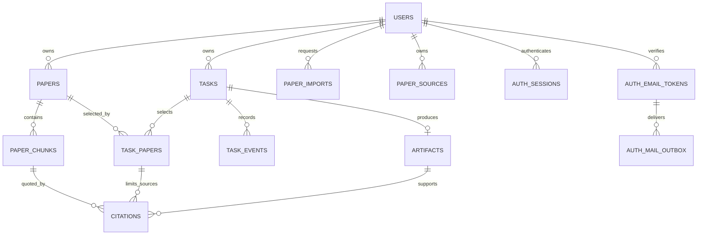

# 后端数据库设计

> 2026-11-20 合并迁移：main 的 `20261118_0006` 保持导入来源元数据字段；Agent 扩展后移至 `20261120_0007`，新增 agent_runs（任务一对一、稳定 dispatch_id、输入清单及摘要、完整 Agent 结果、远程作业 ID、停止原因），tasks 允许 agent Runner，citations 支持原生字符串片段标识并保留旧片段外键。兼容历史上同编号的 Agent 旧库并保留数据。以 Alembic 与 ORM 为准，详细契约见 [Agent 对接](agent-backend-integration.md)。

版本：v1 · 更新日期：2026-11-14。账号增量与当前验收边界见第 11 节；以下 MVP-3 原生数据库证据属于账号迁移之前的历史记录。需求依据：`docs/Proposal.md`；接口对应 `docs/api-contract.md`；当前参考 DDL：`backend/sql/schema.sql`。第 9 节 MVP-3 增量 ORM、迁移和 head DDL 已落地并通过隔离 PGlite 等价检查；2026-11-13 用户在独立原生 PostgreSQL 17.6 验收库完成 head 迁移、无结构漂移检查和八组并发/恢复/共享许可专项验收。该历史专项当时未对现有业务数据库执行迁移；本次实际配置库的 0004 升级/无漂移及空数据状态已验证，见第 11 节。原生专项范围及用户输出记录见 `docs/superpowers/plans/2026-11-12-mvp-3-arxiv-search-import.md`。

本文记录数据设计；应用通过 backend/alembic 的版本迁移建库，backend/sql/schema.sql 保留作结构对照。模型和迁移已落地，操作说明见 backend/README.md；本次实施已验证实际配置库 head=20261114_0004、无结构漂移，详见第 11 节。

## 1. 设计决策

- 目标使用 PostgreSQL 17+；应用层使用 SQLAlchemy 2 + psycopg 3，迁移用 Alembic。UUID 由应用或 PostgreSQL 原生 gen_random_uuid() 生成，不依赖额外扩展。
- `20261114_0004` 引入验证邮箱的账号、会话、邮件及限流五表，并为论文/任务/导入补非空用户归属与用户内唯一键；没有新增租户/工作区表。实际迁移要求旧业务表为空，详见第 11 节。
- PDF 保存到 STORAGE_ROOT/uploads；正文、比较表、引用与事件保存数据库。首版不额外部署对象存储、Redis 或独立日志数据库。
- 初始七张业务表中，MVP-0 使用五张核心表；MVP-1A 开始写入真实解析的 paper_chunks，citations 仍只由后续 Runner 依据证据写入，Mock 不生成伪造片段或引用。
- 引用使用关系表，避免在 artifact JSON 中再保存一套引用；比较表是结构可变的展示数据，采用 JSONB。
- 当前分阶段综述的应用级快照保存在 tasks.review_state；不依赖 LangGraph 内部 checkpointer。如未来引入其内部表，应在独立 schema 使用官方初始化，应用不手工复制内部结构。
- 暂不固定 embedding 维度或创建向量索引；按组员确定的 embedding 模型再迁移增加 pgvector 数据。

### 关系图



### 通用规则

UUID 为主键；时间使用 timestamptz，应用会话按 UTC 读写，API 转为 Z 结尾字符串。created_at 默认 now()；updated_at 由每次实际更新的业务语句显式修改，DDL 未创建自动更新时间触发器。

状态使用 text + CHECK，便于后续迁移扩展。默认 READ COMMITTED；领取和写回必须使用短事务，不能跨模型调用持锁。schema.sql 在空 schema 执行一次，重复执行应失败，不能用 IF NOT EXISTS 掩盖结构漂移。

## 2. 表结构

本节保留初始研究业务结构；0004 的 user_id、联合外键与账号表补充见第 11 节，涉及唯一性时以用户范围为准。

### 2.1 papers：论文及文件

| 字段 | 类型 | 约束/用途 |
| --- | --- | --- |
| id | uuid | 主键 |
| title, original_filename | varchar(255) | 非空文本；API 另校验文件名 |
| storage_key | text | 非空且唯一，必须等于 uploads/{id}.pdf |
| content_type | text | 固定 application/pdf |
| size_bytes | bigint | 1—52428800（50 MB），`papers_size_bytes_check` 约束 |
| sha256 | varchar(64) | 小写十六进制，不做全局唯一 |
| status | text | uploaded / processing / ready / failed |
| page_count | integer, nullable | 正数；ready 必须有值 |
| parser_version | text, nullable | ready 必须有版本 |
| parse_worker_id | uuid, nullable | 后续 Parser Worker 的领取者 |
| parse_lease_expires_at | timestamptz, nullable | processing 必须有租约，其他状态必须为空 |
| error_code, error_message, error_details | varchar(64), text, jsonb | 仅 failed 必填，details 为对象；其他状态全为空 |
| created_at, updated_at | timestamptz | 非空，更新时间不早于创建时间 |

MVP-0 上传后为 uploaded；启动独立 Parser Worker 后，从 uploaded 领取解析工作，按 processing → ready/failed 更新，使用独立于研究任务的租约；无需把内部 parse 类型混入对外 summary/qa/review。当前实现仅提取文本型 PDF，不支持 OCR。

相同文件允许重复上传为不同论文 ID，用于未来解析版本隔离。文件与解析结果一旦被任务引用，服务层禁止原地改写；数据库复合外键另外防止修改已被 task_papers 固定的 SHA-256。

手动上传的 `title` 初始为原文件名去掉扩展名，解析完成后从 PDF 标题元数据或首页显著标题补齐。只替换仍等于初始文件名的标题，不覆盖独立设置的标题或 arXiv 来源标题；无法可靠识别时保留兜底值。该过程不修改原文件、SHA-256、原文片段和已冻结的研究任务来源快照。既有 `ready` 记录可用 `app.papers.refresh_titles` 单独补齐标题，无需新增列或重建数据库。

### 2.2 paper_chunks：可回溯原文片段

| 字段 | 类型 | 约束/用途 |
| --- | --- | --- |
| id | uuid | 主键 |
| paper_id | uuid | 外键 papers；删除无任务引用的论文时级联 |
| chunk_index | integer | 全文顺序，从 0 开始；与 paper_id 联合唯一 |
| page_number | integer | 物理 PDF 页码，从 1 开始 |
| content | text | 非空、固定后的提取原文 |
| content_sha256 | varchar(64) | 原文 UTF-8 字节的 SHA-256 |
| parser_version | text | 非空解析版本 |
| created_at | timestamptz | 创建时间 |

单个 chunk 不跨物理页。服务层检查 page_number 不超过论文 page_count；只有成功产出可引用文本后才将论文置 ready。扫描件无法提取文本且没有 OCR 时应失败，不假装已经可检索。

UNIQUE(id, paper_id, page_number) 供引用使用复合外键，同时锁定片段、论文和页码。被引用 chunk 不可删除；内容不可变性和 hash 重算由服务层保证，CHECK 不会自动重算文本 hash。

### 2.3 tasks：执行与评估快照

| 字段组 | 字段 | 约束/用途 |
| --- | --- | --- |
| 标识/输入 | id、task_type、question | task_type 为 summary/qa/review；qa/review 问题非空，最长 8000 字符；summary 可空，非空时同样最长 8000 字符 |
| 路由 | workflow_type、runner_type | baseline/extended；mock/langgraph；由后端配置冻结 |
| 版本 | workflow_version、prompt_version、model_id、dataset_version | 工作流版本必填，其余可空 |
| 执行配置 | run_config JSONB | 非空对象，只放可记录的运行参数，不保存密钥；新综述包含不可变 review_policy |
| 综述快照 | review_state JSONB | 非空对象，默认 {}；冻结证据、阶段结果、请求预留与估算标识 |
| 预算 | max_steps、max_tokens、timeout_seconds | 默认 10/8000/120，硬上限 100/100000/1800 |
| 状态 | status、stage | queued/running/succeeded/failed；阶段允许新增规范代码 |
| 所有权 | worker_id、lease_expires_at | 仅 running 必填，其他状态为空 |
| 事件 | last_event_seq bigint | 默认 0，事务内增加 |
| 幂等 | idempotency_key varchar(128)、request_hash varchar(64) | 键可空，非空时在当前 user_id 内唯一；哈希必填 |
| 使用量 | input_tokens、output_tokens、model_calls、tool_calls | bigint，可空，非负；Mock 必须全部为空 |
| 错误 | error_code、error_message、error_details | 仅 failed 必填，details 必须为对象 |
| 时间 | created_at、updated_at、started_at、finished_at | 生命周期检查，开始/完成时间可空 |

mock 的 model_id 也必须为空。未知数据用 NULL，不用 0 表示“未知”。API 的 is_mock、total_tokens 和各种毫秒耗时均由已有列派生，不维护重复统计。

状态与时间 CHECK 保证当前行合法，但不能阻止任意 SQL 将终态改回 queued。应用必须通过带旧状态/所有者条件的更新实现状态机，不向浏览器开放直接写表。

### 2.4 task_papers：任务的固定来源

| 字段 | 类型 | 约束/用途 |
| --- | --- | --- |
| task_id, paper_id | uuid | 联合主键，避免重复关联 |
| paper_sha256 | varchar(64) | 选定时的源 hash，复合外键绑定 papers(id, sha256) |
| selection_order | smallint | 0—19，在任务内唯一；按规范化 UUID 顺序存储 |
| created_at | timestamptz | 关联建立时间 |

任务删除时级联关联；已被任务引用的论文不能删除/修改来源 hash。任务论文数、summary/qa 恰好一篇、review 至少两篇、论文就绪状态均由创建事务校验；仅靠外键不能保证这些跨行规则。

### 2.5 task_events：持久化事件

联合主键为 (task_id, seq)，seq 从 1 开始。其他字段：event_type、status、stage、message varchar(2000)、payload JSONB、created_at。event_type 为 status/stage/warning/error；payload 是脱敏对象。

追加事件时，在同一事务中锁定/更新 tasks.last_event_seq 并插入该 seq 的事件；失败一起回滚。不使用 MAX(seq)+1，也不允许仅更新状态却遗失对应事件。首版不删除、更新或压缩事件；支持 API 的 after_seq 增量读取。

### 2.6 artifacts：任务结果

| 字段 | 类型 | 约束/用途 |
| --- | --- | --- |
| id | uuid | 主键 |
| task_id | uuid | 外键且唯一，每个任务至多一项产物 |
| schema_version | integer | 当前固定 1，指结果格式，不是数据库迁移号 |
| title | varchar(255) | 非空 |
| content_markdown | text | 非空，服务层限制 UTF-8 最大 2 MiB |
| comparison_table | jsonb, nullable | 对象，包含 columns/rows 数组；内部内容由服务层校验 |
| created_at | timestamptz | 产物创建时间 |

task_type 和 is_mock 从 tasks 派生，引用由 citations 查询，不重复保存。artifacts.task_id 唯一只保证“至多一个”，不保证 succeeded 必有结果；后者必须依靠完成事务及相应集成测试。

### 2.7 citations：结果与证据

字段为 id、artifact_id、task_id、citation_key、paper_id、chunk_id、page_number、quote、created_at。citation_key 在 artifact 内唯一，格式为 C 加正整数；quote 非空。

三组复合外键保证：

1. (artifact_id, task_id) 对应同一任务产物。
2. (task_id, paper_id) 对应任务选定的论文。
3. (chunk_id, paper_id, page_number) 对应同一原文片段及页码。

服务层仍须检查 quote 是 content 原样子串、Mock 无引用、正文/比较表引用键存在；这些检查不是外键能够完成的，也不代表语义支持率已经通过评估。

## 3. 索引与查询

| 查询 | 索引 |
| --- | --- |
| 论文/任务最近列表 | 0004 加 (user_id,created_at DESC)，查询先限定用户再按 created_at/id 排序；保留原全局索引供 Worker/历史查询 |
| 按状态筛选列表 | (status, created_at DESC, id DESC) |
| 任务领取 | tasks(created_at, id) WHERE status='queued' |
| 回收 Worker 租约 | tasks(lease_expires_at) WHERE status='running' |
| 后续解析领取/回收 | papers 对 uploaded、processing 的部分索引 |
| 论文 hash 核验 | papers(sha256)，非唯一 |
| 论文片段按页查询 | paper_chunks(paper_id, page_number, chunk_index) |
| 论文使用记录 | task_papers(paper_id, task_id) |
| 事件增量 | 主键 (task_id, seq) |
| 产物及引用 | task_id 唯一约束、artifact/citation_key 唯一约束、chunk/source 外键索引 |

q 是字面子串匹配；首版小语料接受扫描，不虚构 B-tree 可加速任意子串搜索。数据量上来后再评估 pg_trgm/全文检索；向量检索另行建立匹配模型与维度的索引。

## 4. 事务、任务领取与恢复

### 4.1 创建任务与幂等

1. 按 API 契约规范化请求并计算哈希，存在幂等键则先按 (user_id,idempotency_key) 重查已有任务；不得复用另一用户的结果。
2. 新任务开启事务；按 UUID 顺序锁定当前用户选定 papers，检查归属、数量、状态和来源 hash，避免与解析/来源变更竞争。
3. 插入 tasks、全部 task_papers、seq=1 的 queued 事件，并将 last_event_seq 置 1；一起提交。
4. 同幂等键并发触发唯一冲突时回滚整个事务，再以新事务重查并比较哈希；不能在已失败的事务里继续查询。
5. 同键同输入返回已有任务，同键不同输入返回 409；不增加第二组论文关联或事件。

### 4.2 Worker 领取

租约默认 60 秒，独立心跳每 20 秒续租；worker_id 为进程启动时生成的 UUID。下例使用 SQLAlchemy text 的命名绑定参数，`:worker_id` 由驱动传入，不用字符串拼接；这是短事务中的单条原子领取语句：

```sql
WITH candidate AS (
    SELECT id
    FROM tasks
    WHERE status = 'queued'
    ORDER BY created_at, id
    LIMIT 1
    FOR UPDATE SKIP LOCKED
), claimed AS (
    UPDATE tasks AS task
    SET status = 'running',
        stage = CASE WHEN task.runner_type = 'mock' THEN 'mock_preparing' ELSE 'preparing' END,
        worker_id = CAST(:worker_id AS uuid),
        started_at = clock_timestamp(),
        lease_expires_at = clock_timestamp() + interval '60 seconds',
        updated_at = clock_timestamp(),
        last_event_seq = task.last_event_seq + 1
    FROM candidate
    WHERE task.id = candidate.id AND task.status = 'queued'
    RETURNING task.*
), recorded AS (
    INSERT INTO task_events (task_id, seq, event_type, status, stage, message, created_at)
    SELECT id, last_event_seq, 'status', status, stage, '任务开始执行', updated_at
    FROM claimed
    RETURNING task_id
)
SELECT claimed.* FROM claimed JOIN recorded ON recorded.task_id = claimed.id;
```

无任务返回零行。提交领取事务后再调用 Agent，不能跨网络调用持锁。SKIP LOCKED 用于这里的队列消费，不用于普通一致性业务查询。

### 4.3 心跳、执行超时与陈旧 Worker

- 心跳必须带 `id + status=running + worker_id + 未过期租约` 条件；超出 started_at + timeout_seconds 后不再续租。
- 心跳更新 lease_expires_at、updated_at；不为每次心跳产生可见事件，避免污染研究执行记录。
- API 进程的 TaskManager 监控器每 10 秒清理超时/过期任务；Worker 启动时同样执行清理。监控器只做短数据库操作，不执行 Agent。
- 超过执行 deadline 优先置 failed/TASK_TIMEOUT；否则租约过期置 failed/WORKER_LOST。失败时设置 finished_at，清空所有权/租约，写 error 和终态事件，并递增 last_event_seq，全部在同一事务中完成。
- 多个监控器都使用条件更新，只有成功改变状态的一方追加事件。不得把 API 查询次数当成可靠的恢复调度器。
- API 和所有 Worker 均停机时不会自动改变数据库；服务恢复时先清理过期状态。
- MVP 不自动重新执行失联任务；用户重跑创建新任务，避免重复模型调用与旧结果覆盖。

### 4.4 完成事务

1. 在事务外校验 Runner 结果的 Schema、正文大小、引用来源、原文子串、比较表和 Mock 规则。
2. 开启短事务并锁定任务，确认仍为 running、worker_id 相同、租约未过期且未超执行 deadline。
3. 插入 artifact 和全部 citations，更新真实统计、succeeded、finished_at，清空 worker_id/lease，追加成功事件。
4. 全部提交后前端才看见成功结果；任一步失败都回滚，不可先提交 succeeded 再单独保存正文。
5. 所有权验证失败则丢弃陈旧结果，不允许旧 Worker 覆盖已失败任务。结果写入异常时，以仍拥有有效租约为前提，另开事务记录失败；否则交由监控器处理。

原文片段和引用不可变；解析器升级后如需重新分析，应上传/创建新论文版本，而不是改写历史任务引用的内容。

### 4.5 文件系统与数据库补偿

上传时生成 paper_id，流式写入同一存储卷的临时文件，同时统计大小/hash；校验通过后原子重命名为 uploads/{id}.pdf，再提交论文记录。明确确认事务未提交时，尽力回滚并清除本次上传的临时/目标文件。提交时连接中断等情况可能使提交结果不确定，此时保留目标文件，通过新连接按 paper_id 查询并核对 storage_key/hash；确认已提交则保留文件，只有确认未提交且原事务已结束后才可清理，暂时无法确认则交由后续核对流程处理。

进程在重命名后、数据库提交前崩溃仍可能留下孤儿文件；后续维护命令按宽限期核对存储键并清理，禁止扫描后立即删除仍在上传中的文件。读取发现记录存在但文件缺失时按 API 返回 FILE_UNAVAILABLE。首版没有文件删除 API，不依赖数据库级联自动删除磁盘文件。

真实解析写 chunks、page_count、parser_version 和 ready 必须一起提交；失败不保留半套可查询片段。

## 5. 删除与完整性边界

- 没有公开删除接口。管理操作删除任务时，其关联、事件、产物、引用级联删除；不会删除论文文件或论文记录。
- citations 到 task_papers 的复合外键使用 DEFERRABLE INITIALLY DEFERRED，在事务提交时检查，避免删除整个任务时与另一条产物/引用级联路径的执行顺序冲突。单独解除仍被引用的任务论文关联会在提交时失败，不能绕过来源完整性。
- 已有任务引用的论文受 RESTRICT 保护；引用中的 chunk 同样不可删除。
- 无任务引用的论文删除时可级联其 chunks；文件需要应用补偿清理。

| 规则 | 数据库保证 | 服务层必须保证 |
| --- | --- | --- |
| 主键、关联存在、当前状态/时间合法 | PK/FK/CHECK | 业务状态转移只能向前 |
| 用户内幂等键唯一 | UNIQUE(user_id,idempotency_key)，NULL 可重复 | 输入规范化、哈希、冲突后重查 |
| 论文来源 hash 不被引用后修改 | 复合 FK RESTRICT | 文件内容与 chunk 内容不可变、hash 核验 |
| 任务论文不重复 | 联合主键 | 数量、排序、就绪状态 |
| 每任务至多一个产物 | task_id UNIQUE | succeeded 恰好有一个产物、终态原子提交 |
| 引用不跨任务/论文/页码 | 三组复合 FK | quote 子串、正文/表格标记、语义证据质量 |
| Mock 不伪造 token | CHECK | 无真实引用、正文提示、排除效果评估 |
| JSON 为对象/外层表格数组 | CHECK | 完整 ComparisonTable 与预算业务规则 |
| 事件序号唯一 | 联合主键 | 连续性、last_event_seq 一致、不可修改 |

不要在 CHECK 中编写查询其他表的业务约束；这种约束应使用外键，或在明确的服务层事务里完成。

## 6. 后续迁移路线

1. 已提供 SQLAlchemy 七表模型和 20261110_0001 初始迁移；新开发库执行 alembic upgrade head。SQL 文件是设计参考，不应与迁移脚本在同一库重复执行。后续结构变化创建新 revision。
2. MVP-0 只使用 papers、tasks、task_papers、task_events、artifacts；MVP-1A Parser Worker 原子写入 paper_chunks；citations 留待真实 Runner 按实际证据写入。
3. 分阶段综述使用 tasks.review_state 保存应用级阶段状态；如另行启用 LangGraph checkpointer，应在独立 schema 执行官方初始化，不把此列作为其内部 checkpoint 表。
4. 确认 embedding 模型后再引入 pgvector，建议单独建立 chunk_embeddings，固定模型标识、版本、维度和 chunk 关联；不同模型向量不能混用。
5. pgvector 扩展需要相应 PostgreSQL 镜像/安装支持；本次 DDL 不假设普通 PostgreSQL 已安装该扩展。
6. 搜索来源已由 0002 引入，账号/多用户归属由 0004 引入（见第 11 节）；任务取消/恢复、多个 artifact 和对象存储仍需独立设计与迁移，同时升级 API 契约。

## 7. 验收与限制

schema.sql 不含凭据、演示业务数据或扩展安装命令；只在新建测试数据库/空 schema 中执行。它不是可以直接运行在现有生产库上的增量迁移。

2026-11-10 本次验收使用 PostgreSQL 18.6 / PGlite 0.5.16，68 项检查通过、0 项失败。范围包括：七表/13 个显式索引创建、文档内领取 SQL 执行、领取与事件原子写入、重复领取及错误所有者拒绝、合法插入、非法状态/预算拒绝、幂等键唯一性、论文重复关联拒绝、引用跨任务/论文/页码拒绝、来源 hash 保护、删除限制和级联、JSON 外层约束、Mock 使用量约束以及事务失败回滚。

本地 Docker 守护进程当前未运行；因此本次使用临时安装的 PGlite PostgreSQL 引擎验证 DDL 和单连接约束，不把它描述成已部署的 PostgreSQL 服务。真实 PostgreSQL 17+ 的双连接竞争、SKIP LOCKED、死锁/超时、迁移升级与 API/Worker 集成仍须在编码阶段验证。

数据库基础设施落地后补充验收：12 项配置/离线检查、18 项 psycopg 在线迁移/ORM 检查通过；参考 DDL、迁移及 ORM 生成结构的 85 个字段、约束和索引一致，后两份 SQL 分别通过同一组 68 项约束验证。在线测试使用 PGlite socket，不等价于原生 PostgreSQL 的多 Worker 并发验收。

## 8. 官方参考

- PostgreSQL 约束及跨行检查边界：`https://www.postgresql.org/docs/17/ddl-constraints.html`
- SELECT 行锁与队列用法：`https://www.postgresql.org/docs/17/sql-select.html`
- 原生 UUID 函数：`https://www.postgresql.org/docs/17/functions-uuid.html`
- PGlite 的 PostgreSQL WASM 引擎：`https://pglite.dev/docs/`

## 9. MVP-3 来源与导入增量设计

MVP-3 对应 revision 20261112_0002，down_revision=20261110_0001（当前迁移目标 head 为 20261114_0004）；新增三表，不改变原七表历史、Paper 四态、来源 hash 外键或手动重复上传规则。本节记录当时参考 DDL/迁移对齐与旧数据保留、降级保护的证据；0004 的空库升级和 DDL 对齐边界另见第 11 节，不能沿用本节历史结论。初始 revision 保持不变。

### 9.1 paper_sources：已保存 PDF 的来源

| 字段 | 类型/约束 |
| --- | --- |
| id | uuid PK |
| paper_id | uuid 非空唯一，FK papers(id) ON DELETE RESTRICT |
| provider | text 非空，CHECK ='arxiv' |
| external_id | varchar(80) 非空，带版本规范 ID，0004 起与 user_id、provider 联合唯一 |
| metadata | jsonb 非空对象，服务层验证 title/authors/abstract/doi/categories/published_at/source_updated_at |
| created_at | timestamptz 非空 |

不保存任意 URL，链接由 ID 生成；DOI 不唯一；新旧 ID 的版本语法由 DB CHECK 与服务层验证。完整标题最多 2000 字符，Paper.title 为前 255 字符。JSON 外层由 DB 检查，具体字段/长度/UTF-8/NUL 由服务层验证。手动上传无 Source。来源只在 PDF 完成事务创建，之后不原地改写；研究任务仍固定 Paper/SHA-256。

### 9.2 paper_imports：持久化状态与重试

| 字段 | 类型/约束 |
| --- | --- |
| id | uuid PK，成功 Paper 使用同一 UUID |
| provider, external_id | 同上，0004 起与 user_id 联合唯一，失败重试保持同一用户记录 |
| attempt | integer 非空默认 1，>0 |
| status | text，queued/running/succeeded/failed |
| paper_id | uuid 可空唯一，FK papers(id) ON DELETE RESTRICT；仅 succeeded 非空且等于 id |
| worker_id, lease_expires_at | uuid/timestamptz，仅 running 同时非空 |
| started_at, finished_at | queued 均空，running 仅 started 非空，终态均非空 |
| error_code, error_message, error_details | 仅 failed 非空；details 为对象且 retryable 为 boolean |
| created_at, updated_at | timestamptz 非空；updated>=created，执行时间不早于 created，finished>=started |

queued/running/failed 无 paper_id，非 failed 无错误。索引：created_at DESC/id DESC、status/created_at/id、queued partial queue、running lease-expiry partial index。来源唯一键用于去重。

重试锁行并以 expected_attempt CAS，failed/retryable 才 attempt+1/清空旧执行字段；已到 expected_attempt+1 只重放，不重新下载。旧 Worker 写回检查 owner/attempt/运行态/有效租约。

### 9.3 source_request_gates：跨进程上游许可

| 字段 | 类型/约束 |
| --- | --- |
| provider | text PK，CHECK ='arxiv'，迁移初始化一行 |
| next_allowed_at | timestamptz 非空，下次允许请求的数据库时间 |
| owner_id, lease_expires_at | uuid/timestamptz，同空或同非空，owner 是每次许可 token |
| blocked_until | timestamptz 可空，上游共享冷却期限 |

短事务锁行；间隔/冷却满足且无有效 owner 时授予。过期许可额外留 3 秒再回收；连接关闭后匹配 token 释放，将 next_allowed_at 推进至至少 DB 当前时间+3 秒。许可 120 秒；元数据/PDF 总时限 20/90 秒且必须可终止；冷却取较晚期限。不得跨 HTTP 持行锁。

### 9.4 原子性、补偿与验收

- 并发提交依赖来源自然键唯一约束；冲突后回滚、开启新事务重查。
- 同事务创建 Paper uploaded、Source、Import succeeded，Parser 提交后才可见；解析失败不改写导入成功。
- 文件系统不是 DB 原子事务：受控 staging/fsync、固定 UUID、fencing 和对账。commit 不确定保留文件；仅确认回滚/无引用/无活动拥有者时清理，禁止盲删获胜文件。
- Import SKIP LOCKED 领取、租约 30 秒/心跳 10 秒/总时限 180 秒，失效置 failed，仅显式重试回 queued。
- downgrade 存在 Source/Import 时拒绝，不能静默丢来源；空增量表可撤销三表，不触碰原业务表。
- 验收升级/回退/老数据保留、唯一键/FK/状态、并发去重/共享 gate、retry 重放、fencing/回滚/不确定提交；PGlite 与原生 PostgreSQL 多连接/进程证据分开报告。

## 10. 分阶段综述持久化（20261114_0003）

revision 20261114_0003 基于 20261112_0002，新增 tasks.review_state 及对象 CHECK，更新 tasks_lifecycle。历史 run_config、论文、引用和产物不重写，旧任务 review_state 默认为空对象。

新综述使用 langgraph-review-v2，run_config.review_policy 冻结版本、列/章节、证据 registry、单元上下文/输出上限、任务自动预算和重试额度。review_state 包含原始片段快照 evidence、units、usage 和 usage_estimated。每个 unit 以 paper:<UUID> 或 section:<key> 索引，attempts 记录 UUID、owner、状态、输入/输出预留或实际用量、finish_reason 与脱敏诊断；result 仅保存已校验的结构，不保存原始模型响应或密钥。

调用前锁 tasks 行并验证 owner、租约及首次执行截止时间，持久化预留后才发送请求。响应成功时在同一事务结算 usage 并保存已验证结果；无效/失败调用也计入累计用量。缺少完整 usage 或失联导致结果不确定时保留预留并标记估算；不会因 Worker 重启重置。

仅该工作流允许 running → queued，保留 started_at，清空 owner/lease，追加恢复事件；重新领取使用同一截止时间。queued 检查仅对此版本允许 started_at 非空，监控也处理恢复排队期间的超时。历史工作流仍以 WORKER_LOST 终止。所有阶段操作及最终完成都校验当前所有权；旧 Worker 即使返回结果也不能落库。

应用每次修改 JSONB 均整体赋值。全部阶段完成后再次严格校验，artifacts/citations、成功状态和完成事件仍在同一事务发布。迁移降级会丢弃 review_state；如果存在带 started_at 的 queued 任务，旧生命周期 CHECK 会拒绝降级并回滚，应先按正常流程处理任务。

## 11. 账号与资源归属（20261114_0004）

revision `20261114_0004`，down_revision=`20261114_0003`；模型位于 `backend/src/app/db/accounts.py`（由 models 导出），迁移位于 `backend/alembic/versions/20261114_0004_user_accounts.py`。新增以下五表，连同既有七张研究业务表、三张来源/导入/共享 gate 表共 15 张业务表，不含 alembic_version。主应用账号路由/CORS 与业务归属/配额已实现。2026-11-14 本次实施已验证原生所有权 16 项（含参考 DDL/ORM 对照）、账号原生 harness 74 项（无跳过）、原生综述 PostgreSQL 8 项全部通过，实际账号 API 注册/验证/登录/上传/找回/重置/撤销链路通过。默认 discover 共 124 项，68 项通过、56 项环境门控跳过，门控套件已独立原生执行通过。实际配置数据库 head=20261114_0004、无漂移，业务记录/用户/生成文件均为 0，source_request_gates seed 为 1。参考 DDL 已附加由 Alembic 生成的 0004 SQL，隔离 reference_schema 与 ORM 的类型/默认值对照回归已通过。

### 11.1 五张账号表

| 表 | 字段与数据库约束 | 索引/用途 |
| --- | --- | --- |
| users | UUID id；username/username_key varchar(32)、email/email_key varchar(320)、password_hash text 均非空；username_key、email_key 分别唯一；status 仅 pending/active/disabled，默认 pending；email_verified_at 可空；auth_version 默认 1 且 >0；created_at/updated_at 非空 | active 必须有 email_verified_at；服务层规范用户名和邮箱，密码用 Argon2id；无明文密码 |
| auth_sessions | UUID id；user_id 非空 FK users ON DELETE CASCADE；token_hash varchar(64) 非空唯一；auth_version、expires_at、created_at 非空；revoked_at 可空 | user_id、expires_at 索引；原始随机 Cookie token 不入表，认证同时检查用户状态/版本、到期和撤销 |
| auth_email_tokens | UUID id；user_id 非空 FK users CASCADE；purpose 仅 verify_email/reset_password；token_hash varchar(64) 非空唯一；expires_at、created_at 非空；consumed_at/revoked_at 可空 | (user_id,purpose)、expires_at 索引；用途隔离、一次消费、可撤销，原始 token 只在加密邮件载荷中暂存 |
| auth_mail_outbox | UUID id；user_id 非空 FK users CASCADE，token_id 非空 FK auth_email_tokens CASCADE；payload_ciphertext text 可空；locale varchar(5) 默认 zh-CN；status 为 queued/sending/sent/failed；attempts 默认 0 且在 0—3；next_attempt_at、created_at、updated_at 非空；worker_id/lease_expires_at/error_code 可空 | next_attempt_at 的 queued 部分索引；CHECK 要求 sending 当且仅当 worker_id 和 lease_expires_at 同时非空。服务层领取/结束同时维护租约字段，sent/failed 清空载荷；实际邮件 locale 使用 zh/en |
| auth_rate_buckets | bucket_key text 主键；count integer 非空且 >0；expires_at 非空 | expires_at 索引；bucket_key 为限流 scope/目标经 AUTH_RATE_KEY 的 HMAC，不明文保存邮箱/IP/用户名 |

users 的状态/版本和唯一键是数据库底线；用户名 ASCII/保留名、邮箱最长 254 字符与格式、密码 6—128 字符且不 trim 等由服务/API 校验，不能根据 email 列容量推断接口上限。两类 token/session 均从 32 随机字节生成，数据库存 SHA-256；CSRF 是独立 AUTH_CSRF_KEY 对会话的 HMAC，不新增明文 token 列。

### 11.2 研究资源归属与联合外键

| 既有表/资源 | 0004 变化与查询要求 |
| --- | --- |
| papers、tasks | 新增非空 user_id FK users ON DELETE RESTRICT；各加 UNIQUE(id,user_id) 和 (user_id,created_at DESC) 索引；列表、详情、下载和任务提交均限定当前用户 |
| tasks 幂等 | 删除全局 idempotency_key 唯一约束，改 UNIQUE(user_id,idempotency_key)；NULL 仍可重复，冲突后按同一用户重查 |
| task_papers | 新增非空 user_id FK users RESTRICT；(task_id,user_id) 联合 FK tasks(id,user_id) CASCADE，(paper_id,user_id) 联合 FK papers(id,user_id) RESTRICT；保留原 Paper/SHA-256 快照 FK，数据库拒绝跨用户选论文 |
| paper_sources、paper_imports | 新增非空 user_id FK users RESTRICT；自然键改为 UNIQUE(user_id,provider,external_id)；加 (paper_id,user_id) 到 papers(id,user_id) 的 RESTRICT 联合 FK 和 user_id 索引。Import 的 paper_id 仍只在成功后非空，其他状态允许空 |
| paper_chunks、task_events、artifacts、citations | 通过已认证且归属正确的 Paper/Task/Artifact 继承访问控制，保留原来源完整性约束，不盲目给每个展示对象增加客户端 user_id |
| source_request_gates / 上游成功元数据缓存 | 保留跨用户共享的上游节流/缓存；本地导入历史、PDF、解析状态及用户注释必须按当前用户重新投影 |

API 从会话获取用户，业务输入不接受 user_id；所有资源 ID 查询均与该用户组合，其他用户资源与不存在资源统一 404，未登录 401。数据库 FK 约束保护写入归属，不能代替读接口、私有 PDF、事件、产物和引用的鉴权。用户有业务数据时 RESTRICT 阻止直接删除用户，不可只因账号附属表配置 CASCADE 就假定可以删除全部业务。

### 11.3 账号事务、限流与邮件租约

注册在同一事务创建 pending 用户、用途 token 和 Fernet 加密 outbox，唯一冲突整体回滚并返回通用注册不可用错误。重发/找回先限流，再按用户行锁处理；不存在或状态不符仍通用 202，不插入可投递邮件。重发撤销同用途旧 token 并终止其待发载荷。验证和重置按用户后 token 的固定锁序，消费时校验用途、状态、到期与撤销，验证还须检查注册时原密码。

验证默认 24 小时，重置默认 30 分钟；验证实际到期不晚于用户 created_at + 24 小时，重发不延长注册总窗口。到期 pending 账号在后续冲突注册时可受控删除后重新注册；存在会话或业务外键阻止删除时不会强行回收。不是定时全库清理任务。改密/重置在同一事务更新 password_hash、递增 auth_version、撤销所有会话及未消费邮件 token；退出只撤销当前 session。

限流表使用 PostgreSQL INSERT ON CONFLICT 原子计数，以数据库时钟和失效窗口供多个 API 进程共享；每次限流事务最多删除 100 个过期 bucket。注册每 IP 10 次/小时；登录每 IP 30 次/分钟、每规范用户名 10 次/15 分钟；验证/重置共用 token_ip 30 次/15 分钟；改密每 IP 30 次/15 分钟、每用户 10 次/15 分钟。邮件申请（注册/重发/找回共享）每邮箱 1 次/60 秒且 5 次/小时、每 IP 20 次/小时、全局 100 次/小时；未知邮箱同样计数。超限提交计数后返回 429 与 Retry-After，不以业务事务回滚逃避限流。

邮件进程以短事务 FOR UPDATE SKIP LOCKED 领取 queued 或租约过期 sending，attempts 在发信前递增；投递前再复核用户/token/收件人，发信在事务外进行，写回通过 worker_id + 未过期租约隔离陈旧 Worker。租约为 10 * SMTP_TIMEOUT_SECONDS + 60 秒；至多 3 次尝试，可重试错误等待 30/120 秒且须仍在 token 有效期内。终态清空 payload_ciphertext、worker_id 和租约，仅保留脱敏 error_code；载荷无法解密时撤销相应 token。SMTP 已接收而 Worker 未提交 sent 时可能重复投递，不承诺 exactly-once。

账号限流与业务任务/导入配额不同；USER_ACTIVE_TASKS=2、USER_ACTIVE_IMPORTS=2、USER_DAILY_TASKS=20 已由业务服务接入：先锁当前 active 用户行，再按该用户统计 queued/running 工作及 UTC 当日任务，新增与导入重试在容量内才接受；原任务幂等重放先于容量检查。超限返回 429，任务/导入并发限制 Retry-After=30，日任务限制 Retry-After=3600；本次实施已验证原生所有权测试通过；配额中文消息及对应英文诊断映射已补齐，不改变用户内统计与配额事务。审查发现的重置 gate 丢失已修复并通过许可领取/释放回归；配额用户行采用 FOR NO KEY UPDATE，与外键引用锁兼容，导入完成/重试交叠回归已通过。既有综述 review_state、冻结预算、证据来源约束与 Worker fencing 不因账号迁移而改变。

### 11.4 0004 升级、重置与回退边界

当前实际迁移在开始即检查 papers、tasks、paper_imports、paper_sources 是否存在记录；任一非空则拒绝升级。它不自动给旧论文分配账号，不创建 legacy_locked 用户，不允许 nullable user_id 过渡。设计讨论中的旧数据锁定账号不是该导出迁移的实现，不能按那个方案对现有库直接执行。

新建空库可按 Alembic 链升级至 head。已有数据必须先停止 API 与所有 Worker、核对数据库和 STORAGE_ROOT 备份，再按已获授权的范围使用 `app.reset_data` 受保护重置流程（命令见 backend/README.md 第 10.4 节）。本次实施已按用户授权完成旧记录与生成文件清理，结构和版本保留；后续运行仍须显式确认目标。若需要保留旧业务，先另行制定并审核数据归属迁移，不能绕过空库检查或暂时移除约束。

0004 的 downgrade 明确拒绝执行，不能退回匿名共享访问；回退依赖核验后的升级前备份。第 7/9 节的升级、老数据保留和降级记录属于早期 revision，不能视作账号迁移的验收。本次实施已完成上述原生测试验证。成功重置曾删除 arxiv 共享 gate seed，该问题已复现并修复：reset_data 在清表事务中补种，0004 用 INSERT ON CONFLICT DO NOTHING 幂等恢复 seed，实际配置库已补种；正向回归证明 reset 后许可可领取和释放，原生 16 项套件通过。schema.sql 已附加生成的 0004 SQL；test_reference_sql_matches_current_metadata 在可回滚 reference_schema 执行 DDL，比较 ORM 类型/默认值并核对 seed，已纳入原生所有权 16 项通过结果。retry_import/complete_import 的锁冲突已用原生测试复现，并通过兼容外键的 FOR NO KEY UPDATE 配额锁修复；16 项所有权测试已全部通过。真实 QQ SMTP 配置与投递另行验收，本次未进行。

## 2026-11-18 导入来源快照

迁移 `20261118_0006` 为 `paper_imports` 增加可空 `source_metadata JSONB`。仅由服务端已验证的精确版本搜索元数据填充，Worker 读取后校验结构与版本，避免独立 Worker 再次查询相同元数据。历史记录保留 NULL 并支持原查询回退。公开 API 不返回此字段。升级部署先执行迁移，再重启 Import Worker。
